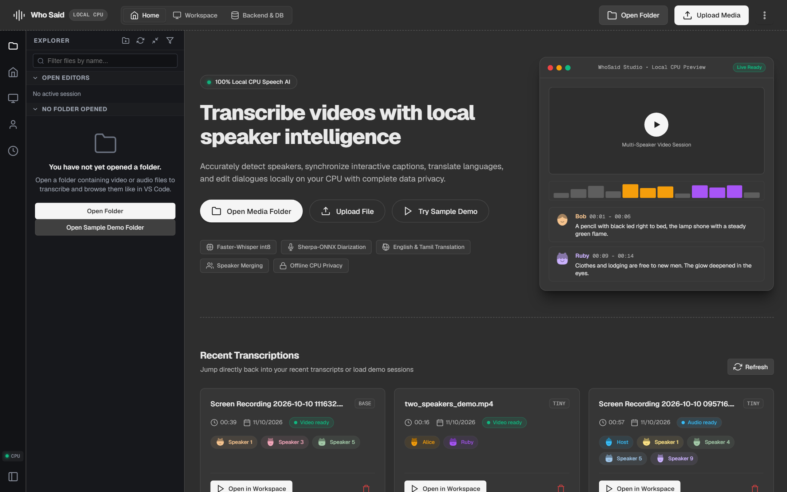
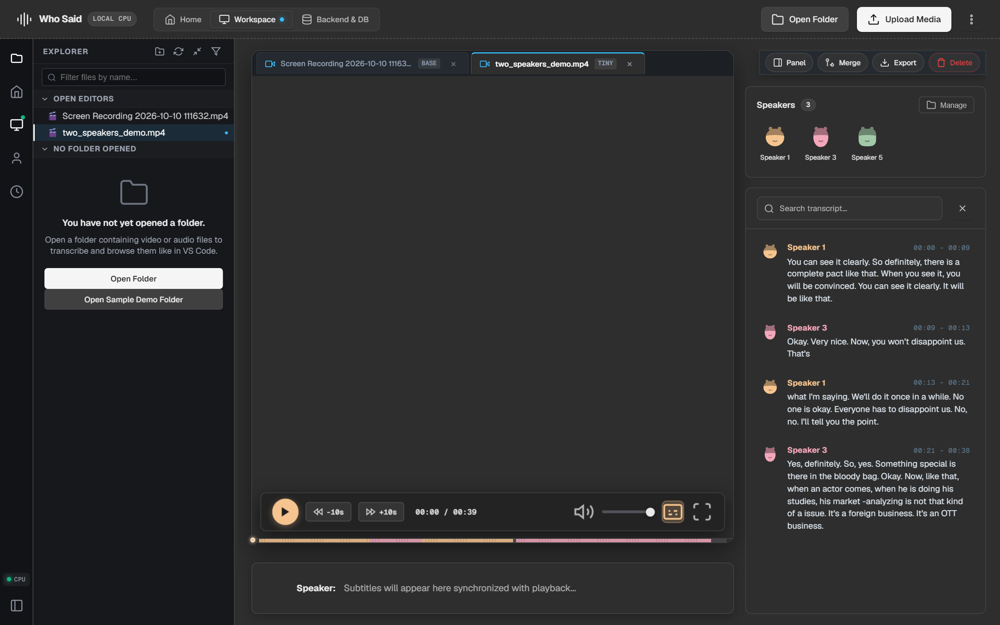
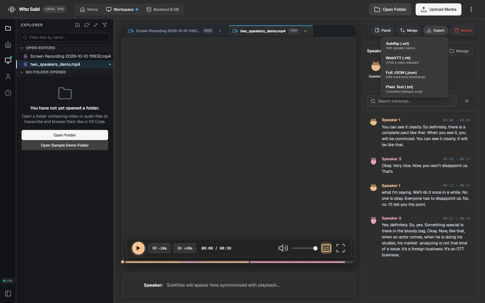

# Who Said — Local Video Transcriber with Speaker Captions

[](LICENSE)
[](https://www.python.org/)
[](https://www.electronjs.org/)
[](https://fastapi.tiangolo.com/)
[](#offline--privacy-guarantee)

**Who Said** is a privacy-first, fully offline desktop and web application that transcribes video & audio files, identifies who is speaking, and plays them back with synchronized speaker-attributed captions, editable transcripts, and interactive waveforms with colored speaker regions.

Everything runs locally on your CPU with **zero cloud calls**.

---

## Screenshots

<p align="center">
  
  <br>
  <em>Home Overview with local folder explorer, activity bar, and recent transcriptions with DiceBear avatars</em>
</p>

<p align="center">
  
  <br>
  <em>Multi-tab workspace with VS Code style tabs, synced OPEN EDITORS panel, video playback, and right-panel controls</em>
</p>

<p align="center">
  
  <br>
  <em>Clean action controls toolbar with one-click export to SubRip (.srt), WebVTT (.vtt), full JSON, and plain text dialogue</em>
</p>

---

## Features

- **Universal Media Ingestion**: Supports `.mp4`, `.mkv`, `.mov`, `.webm`, `.mp3`, `.wav`. Extracts 16kHz mono PCM audio via bundled `imageio-ffmpeg`.
- **VS Code Style Multi-Tab Workspace**: Open, switch between, and close multiple transcription sessions with editor tabs and a synchronized OPEN EDITORS panel.
- **Word-Level Transcription**: Faster-Whisper (CTranslate2, int8 quantized) provides word-level timestamps and speech recognition on CPU.
- **Speaker Diarization**: Offline diarization powered by `sherpa-onnx` (Pyannote ONNX segmentation + CAM++ 3D-Speaker ONNX embeddings).
- **Voice Profiles & Auto-Matching**: Enrolls speaker vocal embeddings (192-dimensional vectors). Automatically matches recurring speakers in subsequent files using cosine similarity (falling back to "Speaker N" if below threshold).
- **Inline Speaker Renaming**: Rename any speaker across the entire transcript with automatic propagation, and save them as permanent voice profiles with one click.
- **Dynamic Caption Overlay**: Real-time video overlay showing `[Speaker Name]: text` with active word highlighting synced to playback.
- **Interactive Waveform**: WaveSurfer.js waveform display with colored speaker regions. Click anywhere on the waveform to seek.
- **Synchronized Transcript Panel**: Click any sentence or word to jump to that timestamp; inline editable text auto-saves to backend database.
- **Progress Tracking & Instant Caching**: WebSocket real-time progress indicator across extraction, diarization, transcription, and turn alignment. SHA-256 caching makes reopening previously processed files instant.
- **Subtitle & Data Exports**: Export as SubRip (`.srt`), WebVTT (`.vtt`), full word-level (`.json`), and readable dialogue script (`.txt`).
- **VS Code Style Folder Explorer**: Browse local directories with an authentic activity bar and collapsible folder tree. Video and audio files are highlighted, pre-cached files show ready indicators, and files can be transcribed directly from disk.
- **All-In-One Self-Hosted Executable**: Bundled Electron desktop shell that self-hosts the backend and connects to the embedded SQLite database with zero external Python runtime required.

---

## Installation & Setup

### Prerequisites

- [Node.js](https://nodejs.org/) (v18+)
- [Python](https://www.python.org/) (v3.10+)

### 1. Clone the Repository

```bash
git clone https://github.com/your-username/whosaid.git
cd whosaid
```

### 2. Install Dependencies

```bash
# Install Node dependencies
npm install

# Install Python dependencies
pip install -r requirements.txt
```

---

## Running the Application

### Option A: Launch Electron Desktop App (Recommended)

Run the desktop application:
```bash
npm start
```
*(Electron automatically starts the backend server, connects to the local database, and opens the application window).*

### Option B: Run via Browser & Python

Start the local server using Python:
```bash
python run.py
```
Open your browser at:
```
http://127.0.0.1:8000
```

---

## Building Standalone Windows Executable (.exe)

Build the 100% self-contained Windows executable bundling frontend, backend engine, and SQLite database:

```bash
# Build standalone installer and portable .exe
npm run build

# Or build single-file zero-install portable executable only
npm run build:portable
```

Outputs in `dist/`:
- **Portable Single-File (.exe)**: `dist/WhoSaid 1.0.0.exe` — Zero-install, portable single `.exe` file that hosts the backend and connects with the database internally with no external Python required.
- **Windows Installer**: `dist/WhoSaid Setup 1.0.0.exe` — Full NSIS installer with desktop & start menu shortcuts.
- **Unpacked Directory**: `dist/win-unpacked/WhoSaid.exe`

---

## Architecture

```
WhoSaid/
├── backend/
│   ├── main.py          # FastAPI application, WebSockets & REST endpoints
│   ├── diarizer.py      # sherpa-onnx diarization & voice profile matching
│   ├── transcriber.py   # faster-whisper ASR & word-level turn alignment
│   ├── audio.py         # ffmpeg audio extraction & waveform peaks
│   ├── db.py            # SQLite database (jobs, transcripts, voice profiles)
│   ├── cleanup.py       # Automated background media cleanup
│   └── exporter.py      # SRT, VTT, JSON, and TXT exporters
├── electron/
│   ├── main.js          # Electron desktop lifecycle & backend process manager
│   └── preload.js       # Secure context bridge IPC API
├── models/
│   ├── model.onnx                                             # Segmentation ONNX (~6MB)
│   └── 3dspeaker_speech_campplus_sv_zh_en_16k-common_advanced.onnx # Embedding ONNX (~28MB)
├── static/
│   ├── index.html       # Single-page application UI
│   ├── app.css          # Modern dark theme & responsive styles
│   ├── app.js           # WaveSurfer sync, caption overlay & editor logic
│   ├── libs/            # Offline WaveSurfer & Regions libraries
│   └── screenshots/     # Showcase screenshots
├── sample_data/         # Multi-speaker sample test files
├── storage/             # SQLite seed DB, uploads, and extracted audio
├── build_backend.py     # Standalone PyInstaller backend packager
├── run.py               # Application launcher
├── requirements.txt     # Python dependencies
└── package.json         # Node.js & electron-builder configuration
```

---

## Offline & Privacy Guarantee

- **100% Offline**: Zero network requests are sent during file processing.
- **Local Storage**: All files, transcriptions, and voice profiles remain exclusively on your computer.
- **CPU Optimized**: Runs fast quantized speech recognition without requiring expensive GPU hardware.

---

## License

This project is licensed under the [MIT License](LICENSE).
